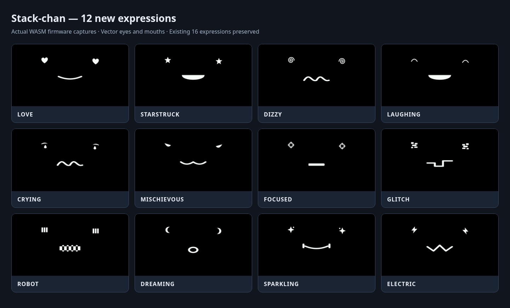

# 表情と行動パターン（CoreS3）

標準ファームウェアには表情28種類、短いリアクション32種類、演技12種類、首のモーション16種類があります。既存の表情の数値IDとパターン名は維持しています。

## 本体で試す

- ドロワーの「診断」→「表情」で全28種類を選択します。WebシミュレーターのLCD内でも同じメニューを使用できます。
- 「遊ぶ」→「リアクション」で32種類の短い仕草を選択します。
- 「遊ぶ」の朝の体操・探検・お祝い・照れながら挨拶・ひらめき・おやすみ・ありがとう・またねで、新しい演技を再生します。

新しい演技8種類は音声を必要としないため、ローカルTTSでも利用できます。演技終了またはキャンセル時には、表情・手・効果・首を元の状態に戻します。会話中は口パクを優先します。

待機時には従来のうなずき・考える・あくびに、好奇心・照れ・ウインク・ほっとする・耳を傾ける・きょろきょろ・伸び・うとうとを加えました。同じ仕草を連続で選びません。静かな時間帯と低電池時は従来どおりあくびに限定します。会話・音声・演技・MOD・一時的な待機抑制が有効な間は自動再生を控えます。

## MOD・会話ツールから使う

```js
robot.reaction.play('curious', { intensity: 0.3 })
robot.performance.play('morning-stretch')
robot.reaction.cancel()
robot.performance.cancel()
```

会話ツール `stackchan.face.setEmotion`、`stackchan.react`、`stackchan.perform` はカタログから選択肢を公開します。Webシミュレーターの操作パネルにも全リアクション・演技を表示します。

| 種類 | 追加した名前 |
| --- | --- |
| 表情 | SURPRISED, CURIOUS, SHY, EXCITED, RELAXED, WORRIED, CONFIDENT, WINK |
| リアクション | surprised, curious, shy, laugh, wink, love, proud, worried, apologize, relieved, listening, look-around, stretch, doze, wake-up, goodbye |
| 演技 | morning-stretch, curiosity-tour, celebrate, shy-hello, thinking-hard, sleepy-bedtime, thank-you, goodbye |
| 首のモーション | bow, double-nod, peek-left, peek-right, scan, stretch |

## グラフィック表情

従来の16種類に加え、目の形自体が変わる12種類を追加しました。表情は「診断」→「表情」、ブロックエディターの「表情を〜にする」、会話ツール `stackchan.face.setEmotion` から選べます。



| 名前 | メニュー表示 | デザイン |
| --- | --- | --- |
| LOVE | ハート | 左右のハートと微笑み |
| STARSTRUCK | スター | 五芒星の目と開いた笑顔 |
| DIZZY | ぐるぐる | 反対向きの渦巻きと波形の口 |
| LAUGHING | 大笑い | 山形に閉じた目と大きな笑い口 |
| CRYING | 大泣き | 涙のしずくと震える口 |
| MISCHIEVOUS | いたずら | 斜めの目と猫のような口 |
| FOCUSED | 集中 | 照準の目と引き締めた口 |
| GLITCH | グリッチ | 分断されたピクセルの目と階段状の口 |
| ROBOT | ロボット | LEDバーの目とグリル状の口 |
| DREAMING | 夢見る | 三日月の目と小さな丸い口 |
| SPARKLING | きらめき | 光芒と小さな光の目、笑顔 |
| ELECTRIC | ビリビリ | 稲妻の目とジグザグの口 |

```js
import { Emotion } from 'face-state'

export function onContextCreated(robot) {
  robot.face.setEmotion(Emotion.STARSTRUCK)
}
```

新しい目・口はベクター描画で、SimpleFaceとSmallFaceで使えます。まばたき・視線移動・テーマ色・口パクにも追従します。DogFaceは共通の目のみ変化し、犬の口は維持します。RelaxedFaceと画像の顔はそれぞれの描画・スプライト／アバターパックに従います。画像素材自体は増やしていません。

首は既存の制限（yaw ±π/6、pitch ±π/8、最短移動150ms）の範囲で動きます。実機では「遊ぶ」から各演技を再生し、可動域、サーボ音、終了時と中断時の復元、会話中の口パクを確認してください。

## 操作に応じたリアクション

CoreS3の頭部タッチパネルで、次の操作を試せます。LCDの顔のタップも、会話接続がないときは短い挨拶になります。会話接続があるときの顔タップは従来どおり会話の開始・停止・割り込みです。

| 操作 | 反応 |
| --- | --- |
| 短くタップ | 気づいてウインク／つんつんされていたずら顔 |
| 素早く2〜3回タップ | くすぐったそうに大笑い／星の目からきらきら喜ぶ |
| 約0.9秒長押し | 目を細めて甘える／照れてハートの目 |
| 一方向にスワイプ | 少し待ってから、その方向を気にして首を向ける |
| 1.5秒以内に前後へスワイプ | 従来のなでる動作。繰り返すと笑顔・ハート・きらきらへ変化 |
| シェイク／逆さ／横倒し／前後への転倒 | ぐるぐる／驚き／好奇心／心配の表情 |

同じタップ操作でも2種類の反応を交互に使います。連続タップは最後の指離しから350ms後にまとめて判定し、一方向のスワイプはなでる操作との区別のため1.6秒待ちます。長押しは指を離すまで1回だけ反応します。

会話・音声・手動の演技・ミニアプリ・ドロワー・MOD・待機抑制・低電池時には、新しい自動タッチ反応を控えます。会話やアプリが始まったら、自分が開始した反応だけを終了します。手動リアクションを中断せず、操作を後からまとめて再生しません。静かな時間帯は首を動かしません。新しい8種類には音声・LED点滅がなく、終了時は直前の表情に戻ります。MODの従来のなでる・姿勢検出処理は維持しています。

追加したリアクション名は `head-hello`, `nose-boop`, `tickled`, `head-cuddle`, `look-touch-left`, `look-touch-right`, `happy-sparkle`, `bashful` です。本体の「遊ぶ」→「リアクション」、会話ツール、Webシミュレーターからも選べます。シミュレーターには「頭をタップ」「連続タップ」「頭を長押し」の入力ボタンを追加しています。
